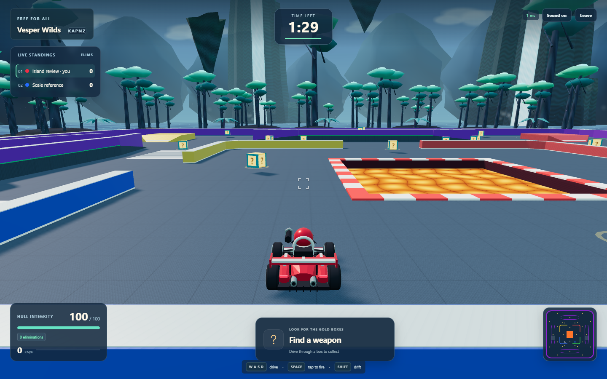
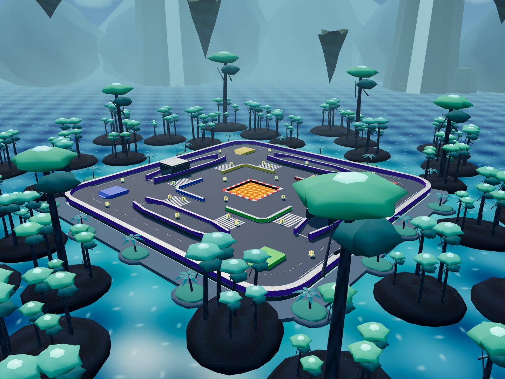

# Vesper Wilds: alien world and authoritative combat

Implemented in the existing Crossfire Karts repository on 2026-10-12. The private room system, eight-player Free For All, three-minute matches, pickup deadlines, scores/respawns, Formula-inspired karts, unique liveries and Render architecture are retained.

## Visual review





Review the [south](alien-review/horizon-0.png), [east](alien-review/horizon-1.png), [north](alien-review/horizon-2.png) and [west](alien-review/horizon-3.png) driving views, [top-down layout](alien-review/top-down.png), [kart](alien-review/formula-kart.png), [nine liveries](alien-review/liveries.png) and [ready siege cannon](alien-review/siege-cannon-ready.png). Hardware captures use production scene builders, lighting and the actual built client/server; their [capture record](alien-review/capture.json) reports no renderer errors. The prior tropical release remains in [its separate report](visual-upgrade.md).

- Eight layered waterfall cliffs, 340–396 units from the origin and 112–148 units tall, with animated water curtains and pooled GPU mist.
- Twenty-four ridged mountain silhouettes, lower satellite cliffs and twelve original floating rock formations create overlapping scenic depths.
- Thirty-two forest islands carry 192 instanced trees with branching trunks, buttress roots, layered organic canopies and luminous crown blossoms. Bounded luminous spores and drifting valley haze provide ambience.
- A blue/violet sky, layered soft clouds, banded alien moon, atmospheric fog and warmer sunlight establish an original sci-fi palette. No copyrighted world assets or downloaded artwork are used.
- Animated ocean ripples, shoreline foam, sun glints and a view-angle sky-color approximation give reflective-looking water without an expensive reflection pass.
- Small procedural color/normal rock textures, textured paving, curved lane guides, metallic barrier caps and luminous elevated-deck/portal strips improve surfaces and route definition.
- Two usable tunnels cover parts of existing raised west/east routes. Roofs and pillars share server/client collision boxes, with four meters of driving clearance. Existing ramps, open lanes, combat areas, eight spawns and 28 pickups remain accessible.
- The follow camera uses a 62–67° speed-dependent FOV, slightly lower height and longer look-ahead, while retaining smoothing and obstacle/terrain clipping.

The world is an optimized stylized interpretation of an alien planet. Distant forests, mountains and floating formations are scenery beyond the driving envelope. The existing heightfield supports one drivable floor at each position; the elevated routes and new overhead tunnels do not introduce stacked bridge underpasses or a new general rigid-body engine.

## Weapon issue causes and fixes

The old input handler ignored controls on focused buttons. A Boolean pending-fire state and server held-key edge could also collapse separate taps, especially when movement backlogs were trimmed. Presses just before cooldown readiness were discarded. The cannon used a single-shot activation and only 3.5 units/s upward launch velocity, giving a very shallow arc. Assisted aim predicted from the kart center rather than the actual side-mounted barrel, and muzzle height ignored pitch. Bombs checked walls but only snapped onto the heightfield after movement, allowing raised faces to be crossed before correcting height. Explosion occlusion ignored an initial obstruction and lifted low impacts onto terrain, allowing embedded splash to escape solids.

Controls now capture game keys centrally during connected active gameplay. They prevent browser Space/arrow defaults, preserve editable fields/menu interaction, handle WASD/arrows/Shift/Space together, suppress key repeat, and clear held/pending state on blur, visibility changes and match transitions. Entering gameplay focuses the canvas. An optional validated monotonic `firePress` ID carries tap intent through input serialization and queue trimming; old held-key clients remain supported. IDs already consumed cannot replay an attack. Unsampled taps canceled by blur are not announced later. The server validates equipment, ammo, health and cooldown. A bounded 120 ms near-cooldown buffer improves deliberate taps without queuing arbitrary early presses or activating replacement weapons from held Space.

Machine gun consumes its full 30-round burst after one press; cannon consumes its four-round volley at 0.8-second intervals. Release does not cancel either sequence. Death, disconnect, weapon replacement and replay cancel attacks. Other individual-round weapons retain their existing inventories and tap behavior; bombs remain tap-to-lob with a 1.6-second fuse.

## Assisted bullets

Machine gun and heavy bullets select server-known live, unprotected enemies inside their forward cone and range. Direction alignment dominates the score, followed by distance; slight retention bias prevents unstable target switching. Both present and predicted target positions must have line of sight against shared oriented walls and the same refined terrain sweep used by authoritative projectiles.

Constant-velocity interception is solved iteratively from the actual barrel tip, including target height/vertical velocity. Machine gun uses 28-unit range, ±0.52 rad cone, at most 0.4 seconds lead and ±0.014 rad random spread. Heavy bullets use 32-unit range, ±0.48 rad cone, 0.5 seconds lead and ±0.018 rad spread. Travel remains finite at 76/64 units/s. A changed movement direction can dodge a shot. Every burst round recalculates aim and can switch invalid targets. HUD tracking and turret orientation support both assisted weapons. Clients cannot supply target, damage or hit results.

## Cannon and remaining physics

The siege cannon launches a visible radius-0.44 ball at 26 units/s horizontally and 9 units/s upward under 24 units/s² gravity. Fixed-tick positions use the exact constant-gravity equation; the client uses the same equation for bounded visual extrapolation. The barrel's elevation and mount match the launch direction. Full-segment collision sweeps choose the earliest wall/ceiling, terrain/ramp or kart hit. Impacts explode with five-unit splash, distance falloff, terrain/wall occlusion and original owner immunity. A four-second maximum lifetime bounds cleanup.

Bombs now sweep against terrain sides, wall/roof faces and enemy kart spheres, reflect inward velocity, retain tangential motion and keep their timed fuse. Homing missiles validate visibility/protection, reacquire visible forward enemies after invalidation and use bounded movement prediction/turning. Mines require line of sight before proximity detonation. Bullet impact events retain weapon identity. Splash checks originate at the actual impact point and cannot bypass an enclosing wall or platform. Shields, boost and orbit retain their server-owned duration/contact behavior and share the corrected activation path.

Combat effects use the existing bounded pools: muzzle flashes, bullet/slug tracers, impact sparks, missile trails, bomb fuse sparks, cannon launch smoke, ball smoke, explosive sparks/fragments and ground shockwaves. Cannon sounds remain synthesized. No unbounded emitter or per-projectile dynamic light was added.

## Performance measurements

Windows 11, Intel i5-1334U, 15.7 GiB RAM. Isolated profiles used one 1920×1080 rendered browser plus seven native WebSocket peers, six seconds of warm-up and roughly five seconds of frame sampling.

| Profile | FPS | Mean frame | p95 frame | Draws | Triangles | Quality |
|---|---:|---:|---:|---:|---:|---|
| Iris Xe / ANGLE D3D11 | 60.18 | 16.62 ms | 16.80 ms | 103 | 115,816 | Full |
| SwiftShader software | 6.64 | 150.54 ms | 183.30 ms | 86 | 63,722 | Reduced |

Both reported zero renderer errors. Raw records: [hardware](performance-alien-hardware.json), [software](performance-alien-software.json). The preceding tropical release sampled 60.10 FPS / 47,376 triangles on Iris Xe and 7.50 FPS / 51,080 triangles in software. These short samples use different positions/camera framing and do not isolate causal changes. Added forest detail raises scene complexity while the sampled hardware frame rate remains at refresh rate. Software rendering is not smooth.

The [eight simultaneously rendered software-browser stress test](performance-alien-eight-browsers.json), each 640×720 on this same computer, passed input/snapshot/livery assertions. Its raw frame counts imply approximately **0.30–0.68 FPS per browser**, with up to 5.58-second frame gaps. Rounded `framesPerSecond` values in that test artifact are 0/1; the fractional rates here are calculated from its raw frames/elapsed time. This workload is functional multiplayer evidence, not smooth-play evidence or a hardware capacity test.

The isolated [180-second/eight-player simulation](performance-alien-simulation.json) finished in **1,234 ms**, with **0.256 ms p95 tick/snapshot cost**, 26 peak projectiles and 7,695-byte average snapshots. Its estimated aggregate outbound traffic is 1,202 KiB/s per eight-player room. This is a local synthetic measurement, not a hosted Render capacity claim.

Scenery uses at most 21 draws and no distant shadow casters. Forests/rocks share geometries and materials; compatibility mode retains the complete waterfall/cloud skyline, reduces trees to 64, and hides roots/mist. The 96 clouds use only 192 triangles, replacing the previous sphere puffs. Textures are 128px, scene reflections use a tiny cubemap, shadows use one 1024px map refreshed at most 20 Hz, and combat effects remain capped at 512 particles, 256 skid marks and 16 shockwaves. Quality reduces pixel ratio/shadows after sustained slow frames. Idle menus redraw only when changed. No full-scene postprocessing, volumetric raymarch, new package, asset host or paid service is required.

## Validation

- Final TypeScript check and frontend/backend production builds passed. Vite retains the existing Three.js chunk-size advisory.
- **322 unit/integration tests across 20 files passed**, including 36 new focused regressions for simultaneous Space/driving, rapid taps, button/editable focus, stale input, queue trimming, near-cooldown buffering, malformed/replayed press IDs, dead/replacement weapons, moving/elevated target interception, exact cannon arc/volley, ramp/kart bomb contacts, homing reacquisition, embedded wall/terrain splash, tunnel driving/ceilings/projectile collision and rendering budgets.
- **14 Chromium scenarios passed**: focused-button simultaneous fire, complete cannon/machine-gun sequences, all weapon categories and shared damage, pickups, driving/jumps, paused-render inputs, latency, lifecycle/rejoin, eight concurrent browsers, and separate HTTPS static frontend / secure WebSockets.
- The three affected input/combat browser scenarios were rerun against the final build after stale-input and embedded-splash hardening.
- Compiled production smoke passed with eight actual WebSocket clients and the new fire-press protocol, matching authoritative players/projectiles/pickups, CORS/health, pickup/fire, timer/replay, rejoin and restart-handler checks. Windows invokes the SIGTERM handler over IPC; Linux signal delivery and an actual Render redeployment were not exercised.
- Local hardware/software visual captures and profiles reported no renderer errors. Existing nine liveries remained stable/distinct in the eight-player browser test.

Reproduce from the repository root:

```sh
npm run build
npm test
npm run test:browser
npm run test:production
npm run benchmark -- --alien-upgrade
npm run profile:rendering -- --hardware
npm run profile:rendering
npm run review:visuals -- --alien-upgrade
```

Git validation and publication use only `https://github.com/Rahul120107/smash-karts.git`, preserve existing commits, fetch remote history before publication and push normally to `main`. The Render service/deployment configuration is unchanged.
