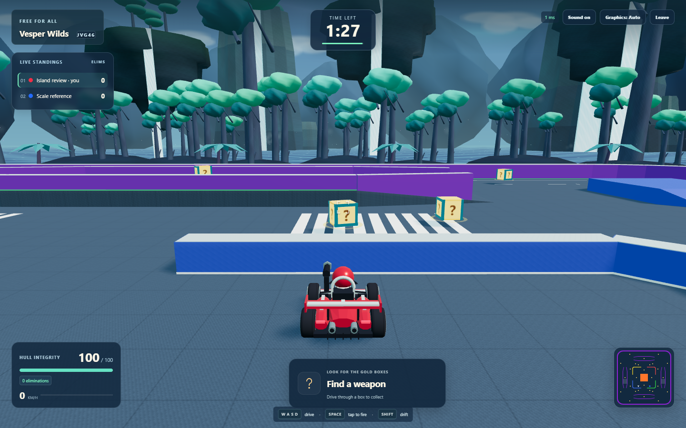

# Vesper Wilds: weapon rework, elimination feedback and fantasy scenery

Implemented in the existing Crossfire Karts repository on 2026-10-12. The eight-player room system, Free For All, authoritative simulation, match/respawn flow, pickup deadlines, Formula-inspired karts, deterministic distinct liveries and Render Free configuration are preserved. This release leaves `shared/src/arena.ts` unchanged: roads, ramps, raised routes, tunnel collision boxes, lava, eight spawns and 28 pickup positions retain their verified geometry.

## Visual review



Review the [overview](fantasy-review/overview.png), [third-person gameplay](fantasy-review/third-person.png), [four](fantasy-review/horizon-0.png) [cardinal](fantasy-review/horizon-1.png) [driving](fantasy-review/horizon-2.png) [views](fantasy-review/horizon-3.png), [playable layout](fantasy-review/top-down.png), [Formula kart](fantasy-review/formula-kart.png) and [nine liveries](fantasy-review/liveries.png). The [capture record](fantasy-review/capture.json) identifies the actual GPU and reports no renderer errors. Review cameras import production scene builders; driving views run the built React client with the real authoritative server.

The two-player combat captures show [the attacker's notification](fantasy-review/killer-notification.png), [the victim's notification](fantasy-review/victim-notification.png) and [Orbit Ram](fantasy-review/orbit-contact.png). The [mobile capture](fantasy-review/mobile-throw-preview.png) shows the held bomb preview and simultaneous touch controls.

Twelve original terraced floating islands replace the earlier cone formations. Their closed mossy caps, fractured lower spires, elevated trees, luminous crystals and cascading streams surround the arena, 184–226 units from the center. Eight enormous 112–148-unit waterfall cliffs, 24 mountain silhouettes and lower cliffs remain farther away. All 20 cascades share the flowing water shader/batch. Forest crowns use smoother geometry and fuller layered silhouettes. The 192 forest trees and 36 skyland trees stay outside the driving envelope. The original sky adds a restrained animated aurora and ring around its distant moon. Clouds, drifting haze, luminous spores, waterfall spray and animated ocean ripples/glints remain bounded.

Original tileable 128px rock color/normal textures add multi-scale grain and moss variation. Existing road paving, barrier caps, luminous boundaries, water, PBR kart panels and metallic trim remain integrated. A slightly higher and longer camera look-ahead exposes more of the horizon while preserving follow smoothing, speed-dependent FOV and collision clipping. There are no downloaded assets, new dependencies, postprocessing passes, scenery colliders inside combat routes or paid services.

## Rear projectile diagnosis and shared mounts

There was no north/south axis inversion: both the kart model and the simulation use **local +Z forward**, transformed to world direction `(sin(yaw), 0, cos(yaw))`. The visible problem had several causes:

- Old gun/cannon tips ended at approximately 1.23/1.115 local Z, inside the 1.34-unit Formula nose. A generic rocket origin also lacked a matching visible launcher.
- Weapons were attached to the chassis that receives cosmetic pitch, roll and suspension, while server muzzle calculations used only the authoritative yaw transform.
- The cannon's 26-unit/s launch did not inherit kart motion. A boosted kart moving at 32.55 units/s could immediately overtake its own cannonball.
- Fire effects used older server positions while the locally predicted kart had already moved. The flash could appear behind the visible kart even when the authoritative spawn was correct.

`shared/src/weapon-physics.ts` now defines explicit pivots/barrel lengths for every weapon. `client/src/weapons/mounts.ts` creates matching named muzzle nodes on the kart yaw root, independent of cosmetic chassis movement. Gun tips extend ahead of the nose; cannon tips include their ballistic elevation; rockets have a visible forward launcher. Bombs launch above/ahead and mines use a rear mount. Local offsets rotate through the full authoritative yaw transform, rather than adding orientation-specific world offsets.

The server owns every projectile origin and velocity. Spread changes velocity without relocating the physical barrel between pellets. A swept center-to-muzzle obstruction check prevents an extended barrel from firing through a wall. Blocked launches produce an actual impact effect. Clients attach unobstructed muzzle flashes to the rendered muzzle; they never relocate authoritative projectiles or predict duplicate projectiles. Owner IDs are excluded from direct and area damage.

Regression coverage compares actual Three.js attachment world positions with the server helper at north/south/east/west and arbitrary angles, including moving, reversing, steering, drifting and airborne launch states. A boosted-kart regression verifies that inherited cannon velocity prevents immediate overtaking.

## Activation and complete sequences

One central input system handles keyboard and touch sources independently. Space/arrow defaults are prevented during active gameplay, including when a HUD button has focus. Editable text fields retain normal behavior. WASD/arrows, drift and firing can be held together. Repeat suppression, blur/visibility clearing, a monotonic validated `firePress` ID, separate `fireHeld`, acknowledgement handling and the existing 120ms near-cooldown buffer preserve quick taps without replaying consumed presses.

`AttackSequences` on the server owns sequence state, cooldowns, ammunition and creation. Release does not stop an automatic volley; holding never starts another complete attack or activates a new pickup. Death, replacement, disconnect, replay and bounded timeout cancel sequences safely. All values below are original configurable balance choices, not measured Smash Karts values.

| Weapon | One activation | Interval / duration |
|---|---|---|
| Machine gun | 30 assisted rounds | 0.105s between rounds |
| Rocket launcher | Three independent rockets | 0.65s |
| Homing missile | Two independent missiles | 0.85s |
| Siege cannon | Four ballistic cannonballs | 0.8s |
| Heavy bullets | Three assisted slugs | 0.3s |
| Proximity mines | Three rear deployments | At least 0.6s and 1.8 units spacing |
| Lob bomb | Hold to preview; release to throw | One bomb, 1.6s fuse from launch |
| Scatter blaster | Five diverging pellets | One volley |
| Blast missile | One large missile | One launch |
| Orbit Ram | Complete rotating contact effect | 6s |
| Invincibility | Complete protected/contact effect | 5s |
| Speed boost | Complete boost | 4s |

Mines wait for movement and check spacing against existing mines instead of stacking. An unsafe initial location also waits without consuming ammo. The eight-second sequence timeout preserves unused inventory for a fresh activation. Bomb charges cancel after 1.5 seconds without fresh control traffic; ordinary movement retains its separate short stale-input timeout. The preview uses shared gravity, launch geometry, inherited motion and the first wall/terrain impact. Cannon is intentionally tap-to-volley, not chargeable.

## Physics and assisted targeting

Machine gun/heavy bullets use server-known live, unprotected opponents, a forward aiming cone and clear wall/terrain line of sight. Alignment is weighted before distance, with slight retention bias. Iterative constant-velocity interception starts at the actual barrel tip and includes enemy height/vertical velocity. Every round recomputes aim and can switch an invalid target. Present and predicted target paths must remain visible. Machine gun uses 28-unit range, ±0.52 rad cone, at most 0.4s lead and ±0.014 rad spread; heavy bullets use 32 units, ±0.48 rad, 0.5s and ±0.018 rad. Finite travel, spread and movement changes allow misses. Clients cannot supply target/hit/damage claims.

Cannon velocity is 26 units/s horizontally and 9 vertically at approximately 19.1° elevation, **plus full kart velocity**, under 24 units/s² gravity. Exact constant-gravity positions are shared with bounded client extrapolation. Radius-0.44 cannonballs use swept earliest-hit collision against walls/ceilings, ramp/terrain and enemy spheres, five-unit occluded splash with falloff and a four-second cleanup lifetime. Launch smoke, visible heavy balls, fragments, shockwaves and distinctive synthesized sounds distinguish the cannon from bullets.

Rockets and blast missiles also inherit kart motion; visual orientation follows their actual velocity. Homing missiles use visible target validation/reacquisition, prediction and a true angular turn limit of 8 rad/s rather than an exponential correction that could snap a boosted launch. Bomb movement now integrates gravity over the actual remaining tick through bounded wall/terrain/kart bounces, retaining the launch fuse. Mines arm after 0.7s and require visibility before proximity detonation. Shared swept collision and impact-origin occlusion keep projectiles/splash from crossing ramps, elevated platforms, tunnel roofs or barriers. All weapons retain original owner immunity.

## Orbit Ram

Three luminous spiked orbs orbit at radius 2.3, speed 10 rad/s for six seconds. The client subtracts kart yaw from the world-time phase, keeping the orbit stable through steering. Server collision sweeps account for orbital rotation and both karts' movement between ticks. Sphere radius 0.55 matches the visible spikes; walls, height and protection constrain contact.

A valid hit deals 38 damage, applies a six-unit/s radial impulse bounded by maximum boosted speed, and starts a 0.5s per-opponent cooldown. It cannot hurt its owner or grant immunity. Three successful contacts are required to eliminate a full-health unprotected opponent. Shield feedback is separately throttled. Contacts are collected before applying damage so simultaneous lethal encounters remain symmetric. Phase, active deadline and damage remain authoritative. Pooled purple trails/contact sparks, impact audio, HUD hit feedback and bounded camera shake make contact clear.

## Elimination architecture

Every lethal server damage path passes its original weapon and owner identity. Delayed projectiles snapshot the owner's display name at launch, so weapon replacement or later renaming cannot alter attribution. Contact attacks supply their actual active weapon. Duplicate lethal processing is stopped by the victim's dead state; nonlethal/owner/protected hits cannot emit a kill or award a point.

Each authoritative elimination event carries killer ID/name, victim ID/name, weapon ID/display name, globally monotonic event ID, match ID and a unique `matchEventId`. Replay increments match identity and clears client feed state. Clients deduplicate events and derive personal messages from those fields:

- Attacker: `You smashed [VICTIM_NAME] using [WEAPON_NAME]!`
- Victim: `You were smashed by [KILLER_NAME] using [WEAPON_NAME]!`

Notifications last a configurable 3.2 seconds, have distinct celebratory/death styling, respect reduced motion and do not intercept controls. The five-second kill feed uses the same captured weapon/names. Names are plain React text and strip control/bidirectional characters and angle brackets; server nickname length validation remains enforced. Environmental lava deaths use a dedicated victim message and award no player score. Death/respawn and the scoreboard use the same server elimination bookkeeping.

## Rendering budgets and measurements

Decorative scenery has at most 24 visible mesh draws (an inactive forest LOD mesh is excluded), with instanced trees, canopies, crystals and floating geology. Ninety-six clouds use 192 triangles. Waterfalls use one shared batch; mist/motes and combat effects use fixed pools. All authoritative projectile kinds now render with shared instanced geometry/materials, limiting each kind to at most three part draws rather than one group of draws per projectile. Empty projectile/pickup batches are hidden. No distant scenery casts shadows.

Graphics Auto adapts foreground frame cost and detects software adapters. Graphics Low sets 0.65 pixel ratio, disables shadows, simplifies the sky shader/forest geometry and reduces vegetation while retaining clouds, waterfalls and floating islands. Full quality caps pixel ratio at 1.25, uses one 1024px sun shadow refreshed at most 20Hz, and a small static environment cubemap. Owned shader textures and inactive LOD resources are disposed with the scene.

Isolated measurements: Windows, Intel i5-1334U, 15.7 GiB RAM; one 1920×1080 rendered browser with seven native WebSocket peers, six seconds warm-up and about five seconds sampling.

| Profile | FPS | Mean frame | p95 frame | Draws | Triangles |
|---|---:|---:|---:|---:|---:|
| Iris Xe / ANGLE D3D11, full | 60.11 | 16.63ms | 16.80ms | 93 | 182,870 |
| SwiftShader, reduced | 7.63 | 131.00ms | 250.00ms | 111 | 76,664 |
| Iris Xe, second sample after browser stress | 48.65 | 20.56ms | 33.40ms | 98 | 186,928 |
| SwiftShader, second sample after browser stress | 5.37 | 186.19ms | 316.70ms | 110 | 77,908 |

All four profiles reported zero renderer errors. Raw [hardware](performance-fantasy-hardware.json), [software](performance-fantasy-software.json), [second hardware](performance-fantasy-hardware-post-stress.json) and [second software](performance-fantasy-software-post-stress.json) records preserve exact values. The previous alien release measured 60.18 FPS on hardware and 6.64 in software. Positions, weapon activity and machine load vary; these short samples do not isolate causal changes or establish sustained worst-case performance. Hardware samples ranged from 48.65 to 60.11 FPS. Software rendering still falls below a playable frame rate.

The [eight simultaneously rendered software-browser stress test](performance-fantasy-eight-browsers.json), at 640×720 each on this same laptop, passed membership, distinct livery, real input and snapshot assertions. Raw counts imply 0.39–0.93 FPS per browser with a maximum 4,166.5ms frame gap and 58–113 draws. Rounded FPS values in the artifact are 0/1; these fractional rates use raw frames/elapsed time. This is functional multiplayer evidence, not smooth-play or eight-device hardware evidence.

The isolated [three-minute/eight-player server simulation](performance-fantasy-simulation.json) completed in 1,346ms, with 0.297ms p95 tick/snapshot, 23 peak projectiles, 7,922-byte mean snapshots and four eliminations. Estimated aggregate snapshot payload is 1,238 KiB/s per eight-player room. This synthetic local result is not a Render-host capacity claim.

## Final validation

- `npm run build`: TypeScript checking, frontend Vite production build and backend TypeScript production build passed. Vite retains the existing large Three.js chunk advisory; it is not a build failure.
- `npm test`: **360 tests in 22 files passed**, 22.74 seconds. Coverage includes shared/actual Three muzzle transforms, cardinal/arbitrary angles, moving/reversing/drifting/airborne origins, complete rocket/cannon/machine-gun/heavy/homing sequences, mine spacing/timeouts, hold/release and stale charge handling, predictive aiming, ballistic arcs, terrain/wall/kart sweeps, splash occlusion, owner immunity, angular homing speed preservation, Orbit contact/cooldowns/knockback/expiry, original delayed-weapon attribution, exact notification text, nonlethal/duplicate kill suppression, input validation and existing room/network regressions. Projectile instancing preserves every template part's world transform, scale and independent instance count.
- `npm run test:browser`: **15 Chromium scenarios passed**, six minutes. Actual built client plus real local servers; focused-HUD Space/WASD/arrows/drift, full bursts and synchronized cannon volleys, all weapon categories, both personal notification messages, score/respawn/protection, room/pickup lifecycle, ramps/jumps, paused animation frames, 120ms latency, reconnect, eight concurrent rendered players with unique colors, mobile multi-touch drive/fire/bomb-release and Auto/Low switching, and separate HTTPS frontend/WSS backend.
- `npm run test:production`: compiled server entry, public PORT binding, CORS/health, eight clients, pickups/weapons, identical authoritative snapshots, timer/replay, disconnect/rejoin and graceful shutdown handler passed. The Windows harness invokes SIGTERM handling through IPC; actual Linux signal delivery is not claimed.
- Local visual capture: all nine scenic/kart views completed on Iris Xe with zero page/shader errors. Attacker, victim, Orbit and mobile screenshots were captured by the passing browser scenarios.
- The three-minute server benchmark and both pairs of isolated rendering profiles completed with finite simulation state and no renderer errors.

The initial complete browser run had one outdated test that held Space and waited for ammunition before releasing a randomly collected bomb. The new hold/release behavior correctly retained that bomb. The test now performs a full tap; the subsequent complete suite passed. No failed check is being counted as a pass.

## Reference scope and assumptions

The [official game](https://smashkarts.io/), [Tall Team](https://tall.team/) and [publisher gameplay description](https://poki.com/en/g/smash-karts) inform observable arcade weapon/control categories. Public community weapon descriptions were also reviewed as secondary material. A linked public trailer could not be fetched in this environment; no footage timings were measured or claimed. Original implementations/assets and the explicit requested complete-sequence/non-one-hit Orbit behavior govern this release. All speeds, damage, counts, radii, cooldowns and lifetimes live in shared configuration and are balance assumptions.

## Reproduction

```sh
npm run build
npm test
npm run test:browser
npm run test:production
npm run review:visuals -- --fantasy-upgrade
npm run profile:rendering -- --hardware
npm run profile:rendering
npm run benchmark
```

Hardware/software profiling runs independently of browser stress tests. Mobile checks emulate a touch browser; they do not substitute for physical phone testing. Hosted Render deployment, actual Linux signal delivery, sustained thermal/browser performance and frame-accurate reference matching remain outside the local evidence. Existing historical release reports and captures remain available separately.
