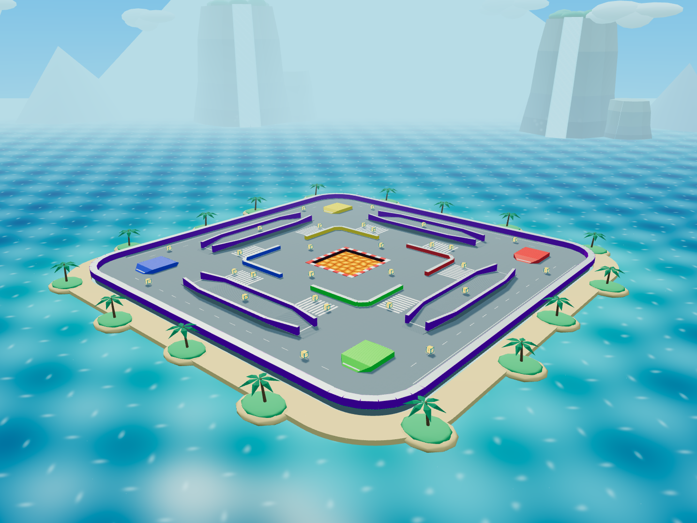
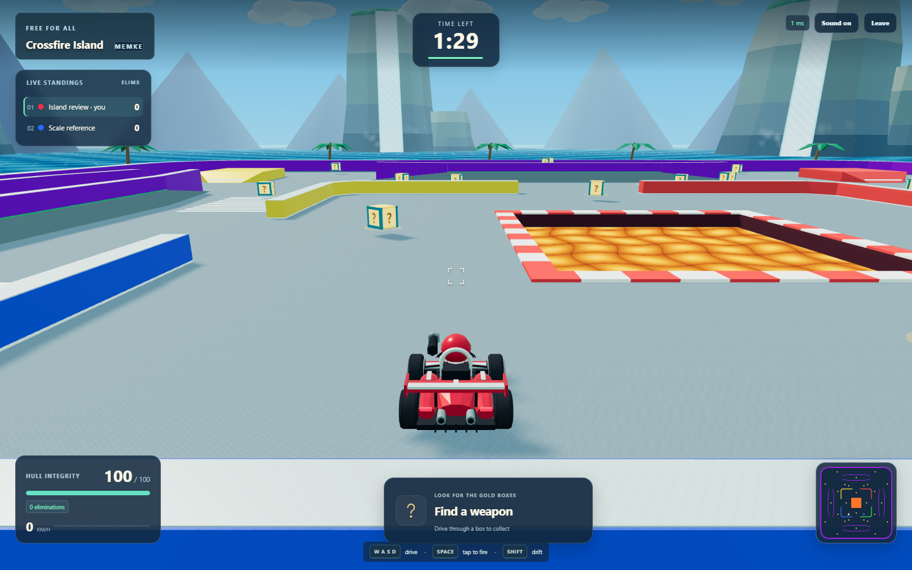
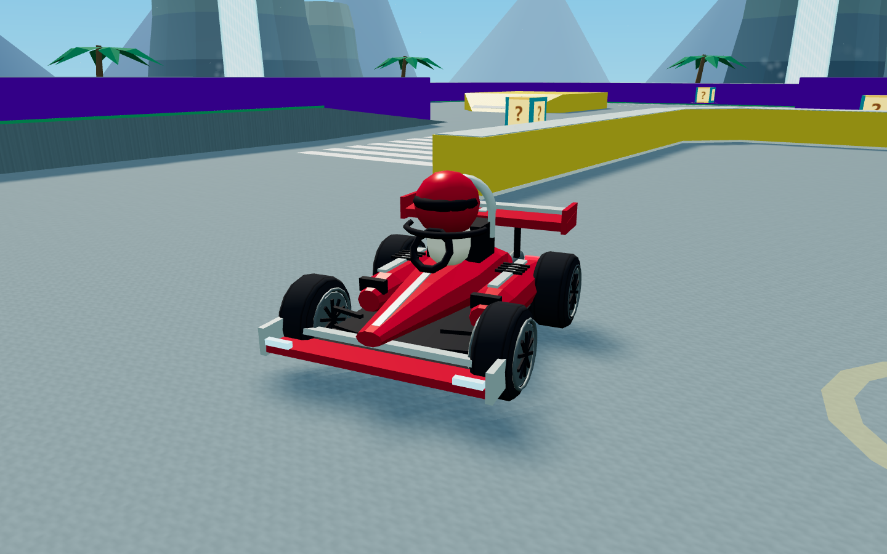
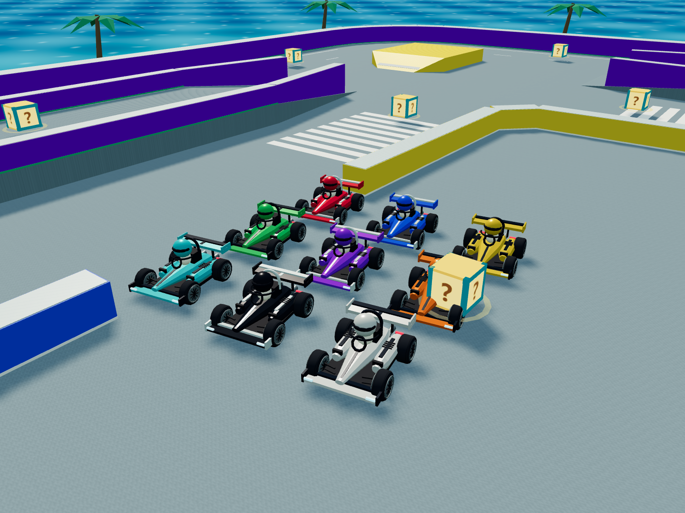

# Crossfire Karts scenic and Formula kart upgrade

This release upgrades the existing island's presentation. Driving geometry, collisions, Free For All rules, room protocol, weapons, pickup timing and Render configuration are preserved. The server change is confined to allocating kart paint at join time.

## Visual review

The [previous overview](map-review/overview.png) and [previous gameplay view](map-review/third-person.png) are retained. The new captures come from the actual scene/kart builders; gameplay uses the built React client and a real local authoritative server. The capture tool provides review cameras only, with no debug menu in the shipped game.





Review the four driving directions: [south](visual-review/horizon-0.png), [east](visual-review/horizon-1.png), [north](visual-review/horizon-2.png), [west](visual-review/horizon-3.png). Waterfalls, mountain silhouettes, clouds and coastal palms frame every captured direction, while ramps, barriers, lava and gold pickups remain readable. The [top-down capture](visual-review/top-down.png) confirms the familiar routes. The original collision plan is retained in the [review layout](visual-review/layout.svg).





The model uses a narrow nose/monocoque, sculpted side pods, open wheels, two-element wings, slick tires, spoke rims, cockpit safety hoop/halo, rear diffuser and twin exhausts. Existing turret, cannon, shield, boost, orbit, steering and suspension animation remain attached. Body, wings and helmet use the same livery; darker colors receive light trim.

## Rendering budget

- Eight waterfall cliffs, 285–341 units from the origin, 66–86 units tall, with lower satellite rocks and foliage. All rock geometry batches into one vertex-colored material; foliage uses one separate batch.
- Eight flowing water curtains share one geometry batch, shader and clock. Fog uniforms and output conversion match Three.js's renderer.
- Twenty-four distant peaks use one instanced draw. Ninety-six cloud puffs use another, with bounded drift and matrix uploads at 10 Hz (2 Hz in compatibility mode).
- Waterfall mist uses 256 GPU-looped points; sea spray uses 64 fixed points. Compatibility mode hides these particles and keeps the complete waterfall/cloud skyline.
- Animated ocean provides shallows, foam, wave crests, sunlight glints and atmospheric distance coloring. A sandy shoreline and low-poly palms stay outside the driving envelope.
- Backdrop budget: at most 13 draws, no scenery shadow casters, no postprocessing or downloaded art. Road grain is a procedural 64×64 texture; the sky uses a 4×256 gradient. Arena and kart parts batch by material. The single 1024 shadow map, adaptive raster resolution, idle-menu redraw policy and eight-player room limit remain.
- Point geometry/materials are included in scene teardown to release the new particle resources.

The deterministic palette allocator rotates through red, blue, yellow, green, purple, orange, cyan, black and white, skips occupied colors, and never recolors existing players. Room regression coverage checks eight unique colors, replacement joins, respawn, replay, snapshot serialization and 20 further turnover cycles. The eight-browser scenario also checks that every client receives the same stable color assignments.

## Local performance

Measured on 12 October 2026, Windows, Intel i5-1334U, 15.7 GiB RAM. Both profiles use one rendered Chromium browser at 1920×1080 with seven native WebSocket peers, six seconds of warmup and a five-second moving-camera sample.

| Renderer | Graphics | FPS | Mean / p95 frame time | Sampled draws / triangles |
|---|---|---:|---|---|
| Intel Iris Xe / D3D11 | Full, shadows/reflections enabled | 60.10 | 16.64 / 16.70 ms | 84 / 47,376 |
| SwiftShader | Compatibility | 7.50 | 133.27 / 233.20 ms | 104 / 51,080 |

Both samples reported zero renderer errors. Raw records: [hardware](performance-visual-hardware.json), [software](performance-visual-software.json). The prior reconstruction recorded 60.06 FPS, 61 draws and 18,918 triangles on Iris Xe. Scene complexity increases, while the sampled hardware frame rate remains at refresh rate. Different player positions and camera framing mean this is not a controlled causal comparison. Software rendering remains too slow for smooth play; the compatibility profile is functional evidence, not a hardware benchmark. These short local samples do not establish worst-case sustained combat performance or hosted Render/WAN capacity.

The [eight concurrent software browsers](performance-visual-eight-browsers.json), each 640×720 on the same computer, passed input/snapshot/color assertions but measured only 0.29–0.57 FPS with maximum frame gaps of 2.03–5.52 seconds and 46–99 draws. This stress workload does not provide smooth gameplay. The previous reconstruction measured approximately 3 FPS in that software-only workload; the richer visuals increase its cost. Hardware performance is the separate Iris Xe measurement above.

The isolated [three-minute/eight-player simulation](performance-visual-simulation.json) finished in 1,117 ms, with 0.224 ms p95 tick/snapshot cost, 24 peak projectiles and 7,710-byte mean snapshots. This is a local synthetic server measurement, not a Render capacity claim.

## Validation

- TypeScript checking and both production builds passed.
- All 287 unit/integration tests across 18 files passed in isolation, including scene batching, compatibility-mode skyline, unchanged map collisions, exact pickup timing, every weapon, camera clipping and stable player color allocation.
- All 13 production-client Chromium scenarios passed (5.8 minutes), including actual keyboard input, all weapon categories, ramps/jumps, lava/respawn, 120 ms simulated round-trip delay, reconnect, eight independent browser players and separate HTTPS/WSS services. Browser observers recorded no renderer errors.
- Compiled production smoke passed public binding, health/CORS, eight clients, combat/pickup snapshots, timer/replay, disconnect/rejoin and the graceful shutdown handler. Windows invoked the signal handler through IPC; actual Linux signal delivery is not asserted.
- Final local review captures show the production scenery in four driving directions and all nine original kart liveries; their renderer/error record is in [capture.json](visual-review/capture.json).
- Deployment architecture and `render.yaml` are unchanged. No Render service was created or redeployed.

## Reproduction

```sh
npm run build
npm test
npm run test:browser
npm run test:production
npm run benchmark
npm run review:visuals
npm run profile:rendering -- --hardware
npm run profile:rendering
```

Run the browser suite and performance profiles separately: eight concurrent software WebGL browsers can starve unrelated CPU tests. The concurrency scenario now focuses the keyboard-accessible canvas and sends real input concurrently, avoiding serial pointer stability waits that could consume the match before setup completed. Match-end and actual keyboard-input assertions remain intact.
